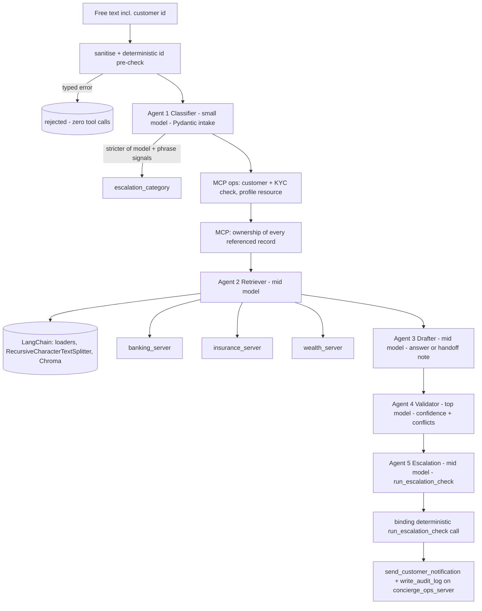
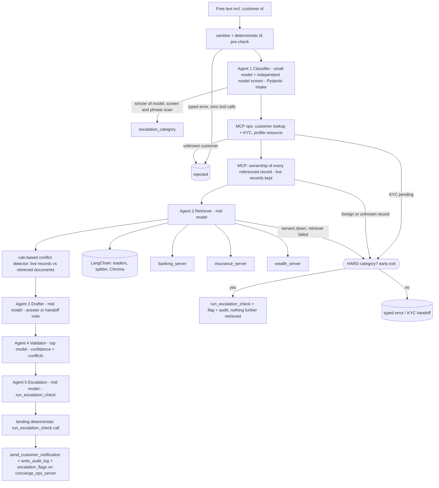

<!-- # Nexus - Architecture

## 1. One request, four layers

The pipeline is one plain function, `handle_request()`; each agent runs as a one-task CrewAI crew so the code can branch between
stages. All backend data is reached only through `mcp_client.py` (deterministic steps) or MCP tools given to agents.

## 2. Layers
| Layer | Implementation |
|---|---|
| Intake (3.2) | `ClassifierOutput`/`Intake` Pydantic models. The customer id and other identifiers are read from the text by regex (never invented by the model); `request_id` is generated server-side; enum values come from `config.yaml`. Failed validation -> `INTAKE_REJECTED` with field-level problems. |
| Retrieval (3.3) | Unstructured: LangChain `DirectoryLoader` (+`TextLoader`/`CSVLoader`) -> `RecursiveCharacterTextSplitter` -> `OpenAIEmbeddings` -> Chroma retriever, exposed to the Retriever as the `search_knowledge` tool; every passage is sanitised. Structured: live MCP tools. The Retriever reports `facts`, `conflicts`, `gaps`; live data is authoritative. |
| Agents (3.4) | CrewAI `Agent`/`Task`/`Crew`, texts in `agents.yaml`/`tasks.yaml`, model tier per agent from `config.yaml`; every task has a guardrail function that makes the agent retry on bad output. |
| MCP (3.1, 7) | 4 FastMCP servers, 13 tools, 4 resource templates, 2 prompts; the pipeline uses the two prompts to build the Classifier and Drafter instructions and the profile resource for the customer's name. |

## 3. Enforced data isolation
`database.connect_for(server)` installs a SQLite authorizer built from `config.yaml` (`database.server_tables`): `insurance_server` can read
`policies`, `policy_clauses`, `claims` only; a join or sub-select into `accounts` is refused by SQLite itself. Banking/insurance/wealth are read-only;
`concierge_ops_server` may only INSERT into `audit_log` and `interaction_log` (append-only). `PRAGMA`, `ATTACH`, DDL and `sqlite_sequence` are denied.
Proof: `database.check_isolation()`, `tests/test_database.py`, demo section 9.

## 4. Escalation
| Order | Rule | Source | Bypassable by rephrasing? |
|---|---|---|---|
| 1 | `hard_category` (financial_hardship, safeguarding_concern, compliance_override_request) | intake: stricter of LLM category and `signals/escalation.yaml` scan of the whole message; enforced in `run_escalation_check` | No - confidence is never read |
| 2 | `low_confidence` (< 0.75) | Validator score | n/a |
| 3 | `invalid_confidence` | missing / NaN / out of range -> fail closed | n/a |
| 4 | `kyc_not_verified` | pipeline, before any account data is retrieved | n/a |
Safeguarding escalations never push a message to the customer's channels.

## 5. Guardrails
| Control | Function | Active at |
|---|---|---|
| Scoped fields | `minimize_*_fields`, `caller_scope` summary/service/full (fields in `config.yaml`) | banking, wealth tools |
| Masking | `mask_identifier(s)` | every tool/resource returning an account/policy/portfolio number; final reply |
| ID validation | `validate_id` (patterns in `config.yaml`) | every tool/resource argument; Pydantic intake |
| Sanitise + injection defence | `sanitize_free_text`, `sanitize_tool_output` (signatures in `signals/injection.yaml`) | customer text, tool output (`ok()`), retrieved passages, outbound messages, prompt arguments |
| Output filtering | `check_output` | Drafter's task guardrail (retry) and the final scenario judge |
| Audit | `write_audit_log` / `add_audit_entry` | notification sent/blocked, resolved, escalated, injection_blocked |
| PII-safe logs | `redact_for_logging` | every `@trace` line |

## 6. Observability
`@trace(logger, redact=...)` logs ENTER/EXIT (DEBUG) and FAILED (ERROR + traceback, then re-raised) as one JSON object per line to
`logs/nexus_trace.jsonl` (`NEXUS_LOG_FILE=stderr` for the console). `LOG_LEVEL` defaults to DEBUG. The MCP servers write to the same file, and
the pipeline reads their ENTER lines to show **ROUTING** (which server/tool really ran) and to verify the Retriever's facts.

## 7. Failure handling
| Failure | Behaviour |
|---|---|
| missing / malformed / ambiguous customer id | typed error before any model or tool call |
| unknown customer | `CUSTOMER_NOT_FOUND` after the single KYC lookup |
| MCP server down | `SERVER_UNAVAILABLE` with the server name; no draft, no guess |
| foreign account / policy / portfolio / claim | `OWNERSHIP_MISMATCH` |
| poisoned document or tool text | quarantined / replaced, audited, request continues |
| LLM/API failure or guardrail retries exhausted | `AGENT_FAILURE` typed error |

## 8. Tests
`tests/`: guardrails, DB isolation on the real schema, all 13 tools, resources + prompts, FastMCP registration (stub or real), tracing, Pydantic intake,
LangChain loaders/splitter/Chroma with fake embeddings, a scripted-LLM pipeline-flow suite, live MCP, and live end-to-end scenarios (need `OPENAI_API_KEY`).
Because agents are non-deterministic, live tests assert properties, never exact wording.

## 9. Trade-offs
* LLM agents give natural answers but vary run to run; the safety-critical decisions (hard escalation, ownership, masking, KYC) are deterministic code or tools.
* One MCP process per call is simple and robust but slow; a long-lived session would be faster.
* One shared SQLite file with an authorizer per server gives the same isolation as four files with less setup.
* Confidence is the Validator's judgement, not a calibrated probability. -->

# Nexus - Architecture
 
## 1. One request, four layers

The pipeline is one plain function, `handle_request()`; each agent runs as a one-task CrewAI crew so the code can branch between

stages. All backend data is reached only through `mcp_client.py` (deterministic steps) or MCP tools given to agents.
 
## 2. Layers

| Layer | Implementation |

|---|---|

| Intake (3.2) | `ClassifierOutput`/`Intake` Pydantic models. The customer id and other identifiers are read from the text by regex (never invented by the model); `request_id` is generated server-side; enum values come from `config.yaml`. Failed validation -> `INTAKE_REJECTED` with field-level problems. The customer-existence/KYC lookup (`get_customer_kyc_status`) is part of intake: it runs right after classification and before any retrieval, drafting or account tool call. A missing, malformed or ambiguous id stops earlier still, with no tool call at all. |

| Retrieval (3.3) | Unstructured: LangChain `DirectoryLoader` (+`TextLoader`/`CSVLoader`) -> `RecursiveCharacterTextSplitter` -> `OpenAIEmbeddings` -> Chroma, exposed to the Retriever as `search_knowledge`; every passage is sanitised. Structured: live MCP tools. "Hybrid" is the spec's meaning: unstructured semantic search reconciled with structured live data. The Retriever reports `facts`, `conflicts`, `gaps`; live data is authoritative. A rule-based detector (`pipeline.detect_conflicts`, rules in `config.yaml conflict_rules`) adds any conflict the LLM missed, by comparing the live records verified by the ownership check with the sentences the Retriever actually retrieved. |

| Agents (3.4) | CrewAI `Agent`/`Task`/`Crew`, texts in `agents.yaml`/`tasks.yaml`, model tier per agent from `config.yaml`; every task has a guardrail function that makes the agent retry on bad output. A sixth, small-model `screener` is an independent second opinion on `escalation_category` (it can only raise it). |

| MCP (3.1, 7) | 4 FastMCP servers, 13 tools, 4 resource templates, 2 prompts; the pipeline uses the two prompts to build the Classifier and Drafter instructions and the profile resource for the customer's name. |
 
## 3. Enforced data isolation

`database.connect_for(server)` installs a SQLite authorizer built from `config.yaml` (`database.server_tables`):
 
| Server | May read | May insert into |

|---|---|---|

| `banking_server` | accounts, transactions | - |

| `insurance_server` | policies, policy_clauses, claims | - |

| `wealth_server` | portfolios, investment_products | - |

| `concierge_ops_server` | customers, interaction_log, escalation_flags, audit_log | interaction_log, audit_log, escalation_flags (append-only) |
 
A join or sub-select into a table a server may not read is refused by SQLite itself; `PRAGMA`, `ATTACH`, DDL and `sqlite_sequence` are denied.

Servers started FOR AN AGENT also get `NEXUS_BOUND_CUSTOMER` / `NEXUS_MAX_SCOPE`: they refuse any other customer's record and any `caller_scope`

above the cap, whatever arguments the model chooses. Proof: `database.check_isolation()`, `tests/test_database.py`, demo section 9.
 
## 4. Escalation

| Order | Rule | Source | Bypassable by rephrasing? |

|---|---|---|---|

| 1 | `hard_category` (financial_hardship, safeguarding_concern, compliance_override_request) | intake: stricter of the Classifier, the independent screen and the `signals/escalation.yaml` scan of the whole message; enforced in `run_escalation_check` | No - confidence is never read |

| 2 | `low_confidence` (< 0.75) | Validator score | n/a |

| 3 | `invalid_confidence` | missing / NaN / out of range -> fail closed | n/a |

| 4 | `kyc_not_verified` | pipeline, before any account data is retrieved (non-hard categories) | n/a |
 
**A hard category is carried through every early exit** (`pipeline.escalate_early`): KYC pending, a foreign or unknown account/policy/claim reference,

a data server that is down, a Retriever failure and any unexpected agent failure after intake. Each still makes the deterministic

`run_escalation_check` call, writes one open `escalation_flags` row plus an audit entry (`early_exit=<reason>` in its details) and retrieves nothing

further. Safeguarding escalations never push a message to the customer's channels, and nothing is sent while KYC is pending.

The one deliberate exception is a request with no verified customer (missing, malformed, ambiguous or unknown id): that stays a typed error

with no tool call (spec 8.2); if its wording carries a hard category the reply also points the customer to a specialist.
 
## 5. Guardrails

| Control | Function | Active at |

|---|---|---|

| Scoped fields | `minimize_*_fields`, `caller_scope` summary/service/full (fields in `config.yaml`) | banking, wealth tools |

| Masking | `mask_identifier(s)` | every tool/resource returning an account/policy/portfolio number; final reply. Product ids are catalogue ids and are not masked. |

| ID validation | `validate_id` (patterns in `config.yaml`) | every tool/resource argument; Pydantic intake |

| Sanitise + injection defence | `sanitize_free_text`, `sanitize_tool_output` (signatures in `signals/injection.yaml`) | customer text, tool output (`ok()`), retrieved passages, outbound messages, prompt arguments |

| Output filtering | `check_output` | Drafter's task guardrail (retry) and the final scenario judge |

| Audit | `write_audit_log` / `add_audit_entry` | notification sent/blocked, resolved, escalated (incl. early exits), injection_blocked |

| PII-safe logs | `redact_for_logging` | every `@trace` line; ids -> last four characters, free text -> length + hash. This is data minimisation: a log line can be correlated with an event but never identifies a person or repeats a message. |
 
## 6. Observability

`@trace(logger, redact=...)` logs ENTER/EXIT (DEBUG) and FAILED (ERROR + identifier-scrubbed traceback, then re-raised) as one JSON object per line to

`logs/nexus_trace.<pid>.jsonl` (`NEXUS_LOG_FILE=stderr` for the console). `LOG_LEVEL` defaults to DEBUG. The tracer is async-aware, so the

persistent-session coroutines are bracketed correctly. Every function is traced except the documented exemptions (the logging bootstrap and the

redaction primitives the tracer itself calls, the `_r`/`_rt` adapters, the cached config getters, context managers / decorator factories / Pydantic

validator hooks, and demo/CLI/UI scripts); the list is in the `logging_config.py` docstring.

Routing evidence (which server and tool really ran) comes from the **call ledger** (`logs/ledger/calls.<pid>.jsonl`, written by the servers themselves, with

hashes of returned figures, never values); the trace logs are only a fallback. The pipeline uses the ledger to drop Retriever facts that no tool backs.
 
## 7. Failure handling

| Failure | Behaviour |

|---|---|

| missing / malformed / ambiguous customer id | typed error before any model or tool call |

| unknown customer | `CUSTOMER_NOT_FOUND` after the single KYC lookup |

| MCP server down | `SERVER_UNAVAILABLE` with the server name; no draft, no guess (a HARD category escalates to a human instead) |

| foreign account / policy / portfolio / claim | `OWNERSHIP_MISMATCH` (a HARD category escalates to a human, revealing nothing about the record) |

| poisoned document or tool text | quarantined / replaced, audited, request continues |

| LLM/API failure or guardrail retries exhausted | `AGENT_FAILURE` typed error (a HARD category escalates to a human instead) |
 
## 8. Agent progress UI

`streamlit_app.py` stacks one bordered, full-width box per agent, built from native Streamlit components (`st.container(border=True)`, `st.columns`,

`st.progress`) in `ui/cards.py`: icon, role, model tier, a coloured status with a live timer, a progress strip, a PROGRESS log (tool, LLM and guardrail

events) beside the agent's OUTPUT (classification, facts and conflicts, draft, confidence, decision), then an Orchestrator box with the deterministic MCP

calls and the outcome. All text is markdown-escaped and identifiers are masked.
 
## 9. Tests

`tests/`: guardrails, DB isolation on the real schema, all 13 tools, resources + prompts, FastMCP registration (stub or real), tracing (sync and async),

Pydantic intake, LangChain/Chroma with fake embeddings, a scripted-agent pipeline-flow suite, hard-category early exits, the rule-based conflict detector,

the agent boxes, live MCP, and live end-to-end scenarios (need `OPENAI_API_KEY`). Because agents are non-deterministic, live tests assert properties,

never exact wording.
 
## 10. Trade-offs

* LLM agents give natural answers but vary run to run; the safety-critical decisions (hard escalation, ownership, masking, KYC, conflict detection) are deterministic code or tools.

* One MCP process per call is simple and robust but slow; opt-in persistent sessions are faster.

* One shared SQLite file with an authorizer per server gives the same isolation as four files with less setup.

* Confidence is the Validator's judgement, not a calibrated probability.

* Customer identity is read from the message text (a production system would take it from an authenticated session).
 